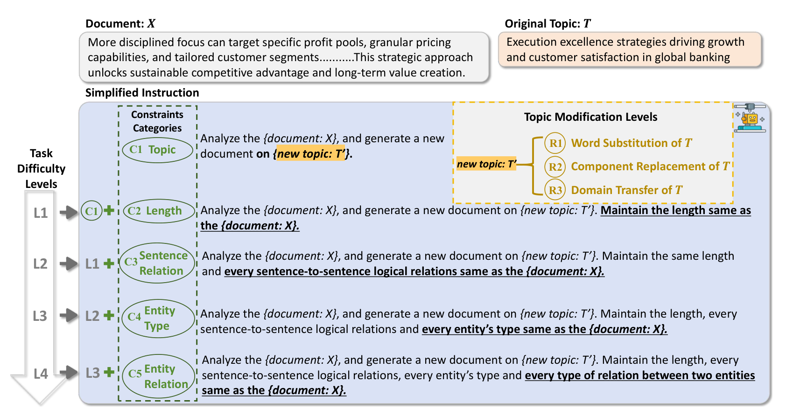
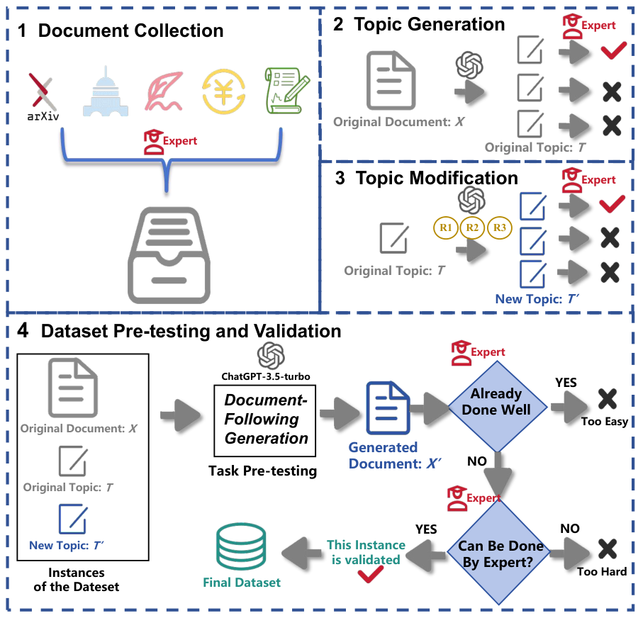

<div align="center">

# DocFollow

### A Hierarchical Fine-Grained Constraints Following<br>Benchmark in Long Contexts for LLMs

**Official code and data · EMNLP 2026**

Yanji He<sup>1,*</sup> · Zhao Yang<sup>1,*</sup> · Yuxin Jiang<sup>2</sup> · Yiqian Yang<sup>1</sup> · Jiaheng Wei<sup>1,†</sup> · Wei Wang<sup>1,3,†</sup>

<sup>1</sup> HKUST (Guangzhou) &nbsp; <sup>2</sup> Huawei Technologies &nbsp; <sup>3</sup> HKUST<br>
<sub>* Equal contribution &nbsp; † Corresponding authors</sub>


<a href="LICENSE"></a>

[Overview](#overview) · [Task design](#task-design) · [Dataset](#dataset) · [Getting started](#getting-started) · [Citation](#citation)

</div>

<p align="center">
  <a href="assets/figures/framework.png"></a>
</p>
<p align="center"><sub>DocFollow evaluates long-form rewriting under increasingly fine-grained constraints, from document length to entity relations.</sub></p>

## Overview

Can a language model read a long document, write a new one on a different topic, and preserve the details of its structure?

**DocFollow** studies this **Long-In-Long-Out Generation** setting through Document-Following tasks. Given a reference document and a modified topic, a model must produce a new long-form document while following a hierarchy of structural and semantic constraints.

| Benchmark instances | Domain coverage | Task configurations | Evaluated LLMs |
| :---: | :---: | :---: | :---: |
| **2,436** expert-validated instances | **5** domains · **20** subdomains | **3** topic shifts × **4** difficulty levels | **13** models |

- **Hierarchical control.** Five constraints probe topic coherence, length, sentence relations, entity types, and entity relations.
- **Controlled topic shifts.** Three modification levels test adaptation from word substitution to transfer across subdomains.
- **Structured evaluation.** LLMs extract atomic information; rule-based programs compute constraint scores.

Our experiments show that strong document-level coherence does not guarantee sentence- or entity-level fidelity. Fine-grained constraint following remains challenging across the evaluated models.

## Task design

Each task combines a **reference document**, a **target topic**, and a **cumulative constraint set**.

| Difficulty | Required constraints | What the model must preserve |
| --- | --- | --- |
| **L1** | C1 Topic coherence + C2 Length | The target topic, sentence count, and sentence lengths |
| **L2** | L1 + C3 Sentence relation | Logical relations between adjacent sentences |
| **L3** | L2 + C4 Entity type | Types of corresponding entities |
| **L4** | L3 + C5 Entity relation | Relation types between corresponding entity pairs |

Topic modification is varied independently: **R1** substitutes key words, **R2** replaces a topic component within a subdomain, and **R3** transfers the topic to another subdomain within the same broad domain.

## Dataset

The paper's benchmark contains **2,436 task instances**. This repository provides the **203 English source documents** used for benchmark construction, organized by domain and writing scenario under [`datasets/documents/`](datasets/documents/).

| Domain | Subdomains | Source documents | Directory |
| --- | :---: | ---: | --- |
| Academic & Engineering | 5 | 54 | [`academic_engineering/`](datasets/documents/academic_engineering/) |
| Education | 5 | 39 | [`education/`](datasets/documents/education/) |
| Finance & Business | 3 | 29 | [`finance_business/`](datasets/documents/finance_business/) |
| Literature & Arts | 3 | 40 | [`literature_arts/`](datasets/documents/literature_arts/) |
| Politics & Law | 4 | 41 | [`politics_law/`](datasets/documents/politics_law/) |
| **Total** | **20** | **203** | |

<details>
<summary><b>How DocFollow is constructed</b></summary>

Documents are collected from diverse sources, paired with original and modified topics, and reviewed by domain experts. Pre-testing and expert validation retain tasks that are challenging for models while remaining feasible for human writers.

<p align="center"></p>

</details>

## Getting started

### Installation

```bash
git clone https://github.com/leonbig/DocFollow.git
cd DocFollow

conda create -n docfollow python=3.12.9
conda activate docfollow
pip install -r requirements.txt
python -m spacy download en_core_web_sm
```

### Run the benchmark

```bash
cd docfollow
python final_main.py --help
```

The pipeline accepts separate model names, API keys, and base URLs for **generation** and **evaluation**. Select a domain directory as input and choose topic levels (`1,2,3`) and difficulty levels (`1,2,3,4`). See the [usage guide](docs/usage.md) for a complete command, output structure, and experiment instructions.

## Code organization

```text
DocFollow/
├── docfollow/                  # Benchmark generation and evaluation
│   ├── final_main.py           # Main pipeline
│   ├── Text_Generator/         # Topic modification and text generation
│   ├── Evaluator/              # C1-C5 evaluation modules
│   └── tools/                  # Alignment, taxonomies, and shared utilities
├── experiments/                # Prompting strategies and ablations
│   └── docfollower/            # Graph-guided DocFollower framework
├── datasets/
│   └── documents/              # Source corpus, grouped by domain and scenario
├── assets/figures/              # Figures from the paper
├── docs/usage.md                # Configuration and running instructions
├── requirements.txt
└── CITATION.bib
```

| Experiment | Implementation |
| --- | --- |
| Chain-of-thought | [`experiments/cot.py`](experiments/cot.py) |
| One-shot / Few-shot | [`one_shot.py`](experiments/one_shot.py) · [`few_shot.py`](experiments/few_shot.py) |
| Self-criticism | [`experiments/self_critic.py`](experiments/self_critic.py) |
| Temperature ablation | [`experiments/temperature.py`](experiments/temperature.py) |
| DocFollower | [`experiments/docfollower/`](experiments/docfollower/) |

## Citation

If you use DocFollow in your research, please cite our paper:

```bibtex
@inproceedings{he2026docfollow,
  title     = {{DocFollow}: A Hierarchical Fine-Grained Constraints Following Benchmark in Long Contexts for {LLMs}},
  author    = {He, Yanji and Yang, Zhao and Jiang, Yuxin and Yang, Yiqian and Wei, Jiaheng and Wang, Wei},
  booktitle = {Proceedings of the 2026 Conference on Empirical Methods in Natural Language Processing},
  year      = {2026},
  url       = {https://github.com/leonbig/DocFollow}
}
```

## Contact & license

For questions, please [open an issue](https://github.com/leonbig/DocFollow/issues) or contact [Yanji He](mailto:yhe720@connect.hkust-gz.edu.cn). The repository is released under the [MIT license](LICENSE).
